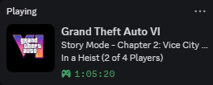

#  Discord RPC Costum

**A lightweight, hassle-free Node.js script to customize and run your own Discord Rich Presence with ease.**

## ✨ Key Features
1. **Built with Node.js:** Fast, simple, and uses minimal system resources.
2. **Direct Image URLs:** Change cover art and icons freely using any direct image link—no need to upload assets to the Discord Developer Portal.
3. **Full Customization:** Easily edit the game title, details, state, and timestamps anytime via `config.json`.
4. **Windows Auto-Start:** Built-in batch scripts to run silently in the background on system startup.

## 📁 Project Files

| File | Description |
| :--- | :--- |
| `start-background.bat` | Runs the RPC silently in the background if not already active. |
| `start-terminal.bat` | Launches the RPC inside a visible terminal window for debugging. |
| `pasang-startup.bat` | Installs the RPC to auto-start silently on Windows boot (no black CMD popup). |
| `hapus-startup.bat` | Removes the RPC from Windows startup if you prefer manual control. |
| `config.json` | Main configuration file for your Client ID, image URLs, and status text. |

## 🚀 Quick Start
1. Clone this repository or download the latest release.
2. Run `npm install` to install dependencies.
3. Edit `config.json` with your Discord Application ID, image links, and custom text.
4. Double-click `start-background.bat` (or `pasang-startup.bat` for auto-start) and enjoy!
